# Human conditional shot-selection pilot

**Pilot only. All five-way human categories are provisional landing proxies. These are reconstructed successful-return outcomes, whereas the robot plots show selected commands. No claim of statistical similarity is supported.**

## Execution and diagnostics

```json
{
  "total_sampled_rallies": 10000,
  "successfully_loaded_rallies": 9980,
  "all_players": {
    "detected_racket_contacts": 49796,
    "valid_net_crossings": 18662,
    "valid_opponent_landings": 16352,
    "classified_shots": 16352,
    "excluded_by_reason": {
      "missing_ball_at_contact": 19250,
      "crossing_outside_net_span_or_below_net": 10947,
      "contact_context_unavailable": 710,
      "table_edge_potentially_clipped_by_reconstructor": 1926,
      "no_vertical_bounce_reversal": 384,
      "no_plausible_longitudinal_contact_reversal": 104,
      "self_half_bounce_or_serve": 117,
      "contact_on_wrong_table_side": 6
    }
  },
  "selected_players": {
    "detected_racket_contacts": 49796,
    "valid_net_crossings": 18662,
    "valid_opponent_landings": 16352,
    "classified_shots": 16352,
    "excluded_by_reason": {
      "missing_ball_at_contact": 19250,
      "crossing_outside_net_span_or_below_net": 10947,
      "contact_context_unavailable": 710,
      "table_edge_potentially_clipped_by_reconstructor": 1926,
      "no_vertical_bounce_reversal": 384,
      "no_plausible_longitudinal_contact_reversal": 104,
      "self_half_bounce_or_serve": 117,
      "contact_on_wrong_table_side": 6
    }
  }
}
```

Default primary analysis is P1 only. Both-player contact diagnostics are retained, and --player p2/both uses the same orientation normalization. Excluded observations stay in shot_events.csv/all_shot_events.csv, rather than being counted as successful categories. Counts are cumulative through validation gates; reasons describe the first failed gate.

## Validation evidence

Top-down shot figures show recorded players/ball positions and ball height versus event timing for up to three accepted examples. Position_zones.png and landing_proxy_regions.png show both coordinate conventions and exact proposed category boundaries. Original-video contact/crossing/landing frame sheets are generated for up to three selected clips, without assuming 2D tracker coordinates are native-video pixels. Video frame count/FPS and inspected indices are recorded in summary.json; these sheets are visual validation aids, not an independent human-labeled contact accuracy score.

## Output compatibility and side-by-side comparison

**Temporal alignment remains unresolved:** the human outgoing-crossing condition follows the hit; robotic incoming-crossing conditions precede the chosen hit. Matching CSV schemas and coordinate signs does not resolve this temporal difference.

[
  {
    "policy": "nash_q",
    "player": "P1",
    "file": "reports/v3/conditional_skill_selection_nash/joint_position_skill_summary.csv",
    "analysis_run": "nash_vs_random_10000_10a705f4"
  },
  {
    "policy": "potential_ibr",
    "player": "P1",
    "file": "reports/v3/conditional_skill_selection_potential_ibr/joint_position_skill_summary.csv",
    "analysis_run": "potential_ibr_vs_random_10000_64900e08"
  }
]

The comparison uses available P1 Nash-Q and Potential IBR CSVs, choosing the most recently modified compatible report for each method (paths/run IDs recorded). No robot evaluation is launched. The same 9 physical-player own-side conditions, five ordering keys, count normalization and colors are used. Human n_policy_vectors=0 is intentional. State occupancy and sample sizes are different; successful human landings are selected while robot commands may include failed outcomes. Do not interpret the plotted differences as behavioral or statistical similarity/dissimilarity.

## Next-step recommendation

Do not scale to the full archive yet. The selected pilot retains 16352 classified shots from 49796 selected-player contacts. Resolve (1) independent manual video checks of contact/bounce association and left/right for more camera views, (2) clipped-edge and invalid-net trajectory handling, (3) validation of provisional regions against actual robot landing distributions, (4) pre-contact versus crossing and pelvis versus foot-midpoint sensitivity, and (5) sparse-cell uncertainty and match-level clustering. Reconstruction checks are partly circular because contacts/bounces anchor the generated trajectories. A balanced multi-match sample and fixed manifest establish reproducibility, not population representativeness. Keep landing coordinates even if proxy regions change.

## Reproduction

```bash
python3 v3/human_comparison/analyze_human.py --data-root v3/LATTE-MV --sample-rallies 10000 --seed 42 --player both --position-time crossing --output-dir v3/human_comparison/reports/10k_both
```

See dataset_investigation.md, sample_manifest.json and summary.json for exact input paths, hashes, available events and all numerical settings.

For the seed-42 pilot, [manual review notes](manual_review.md) record the sparse-frame inspection and its limits. Those notes identify the reviewed rally IDs and do not establish ground-truth event accuracy for other samples.

## Figures

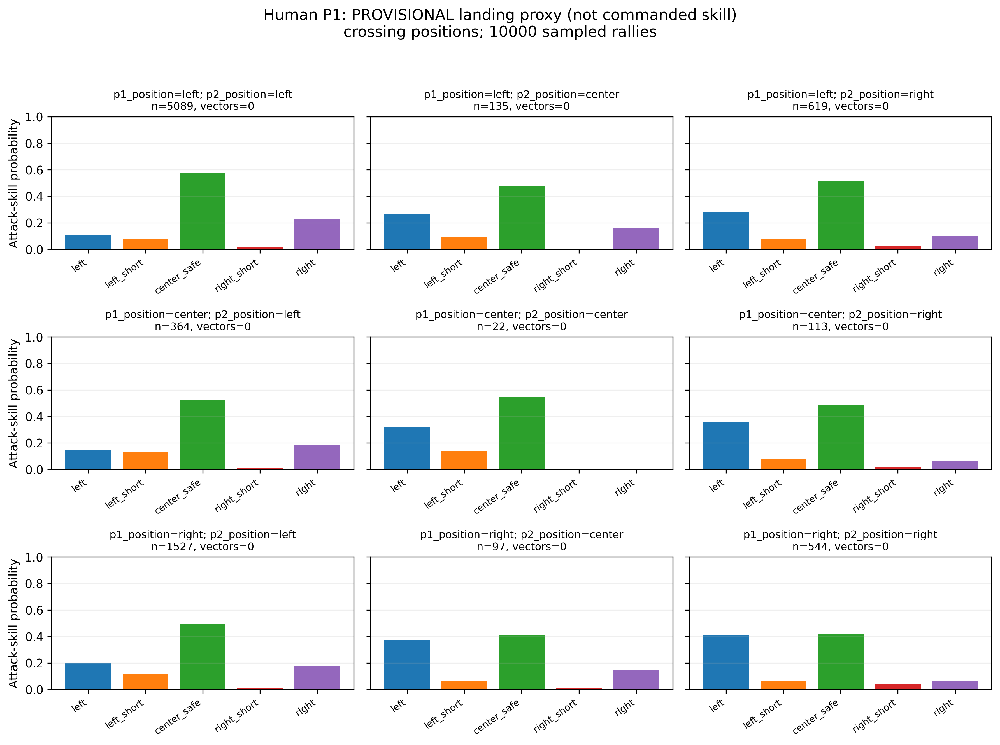

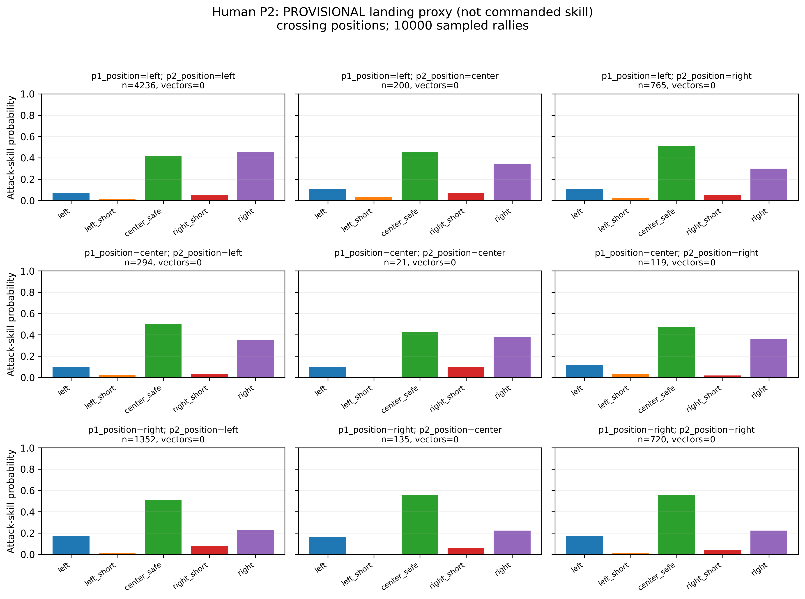

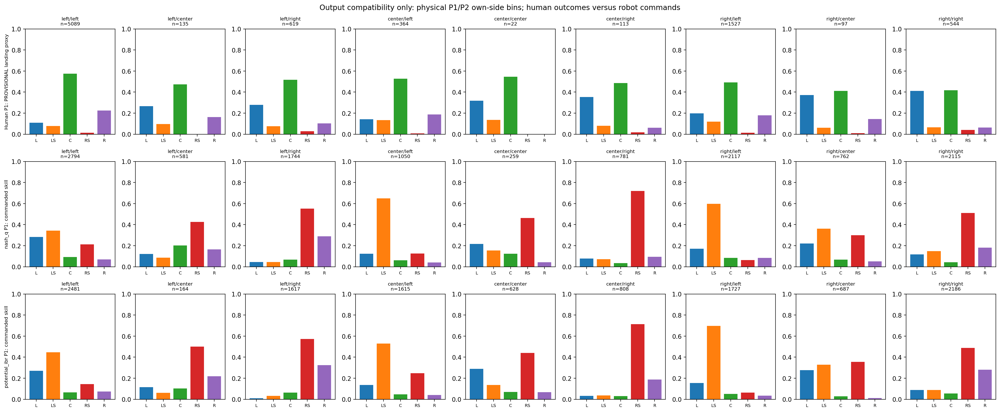

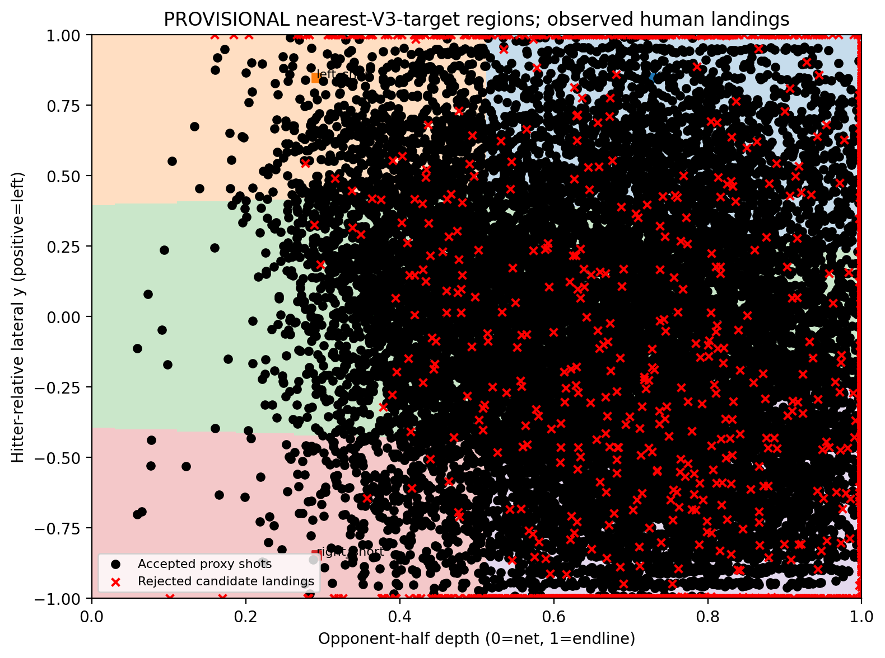

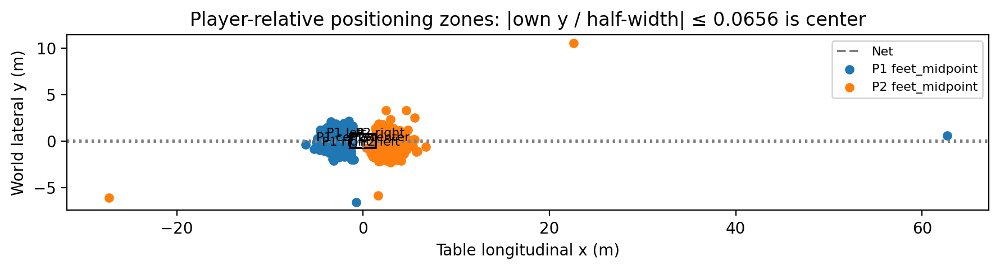

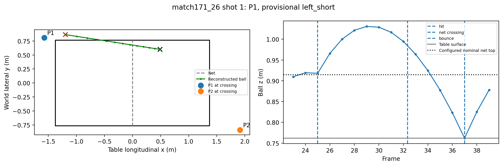

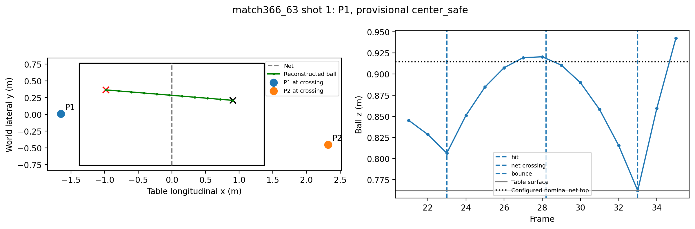

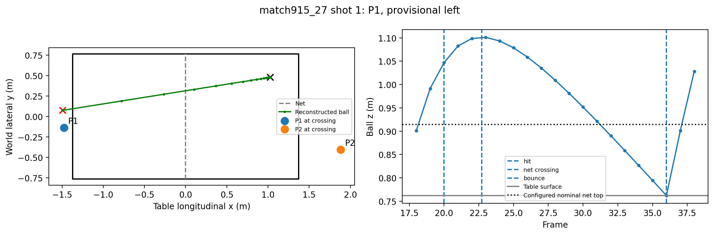

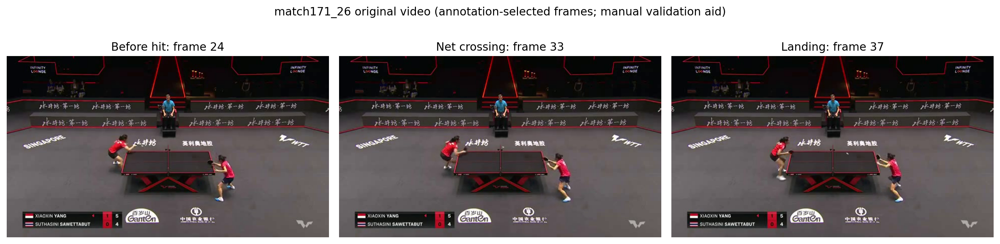

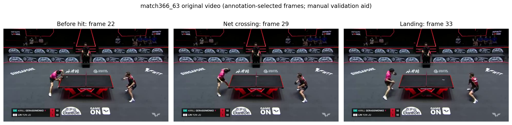

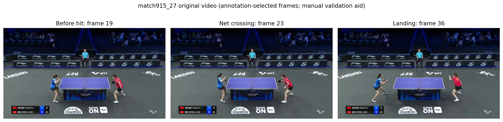
