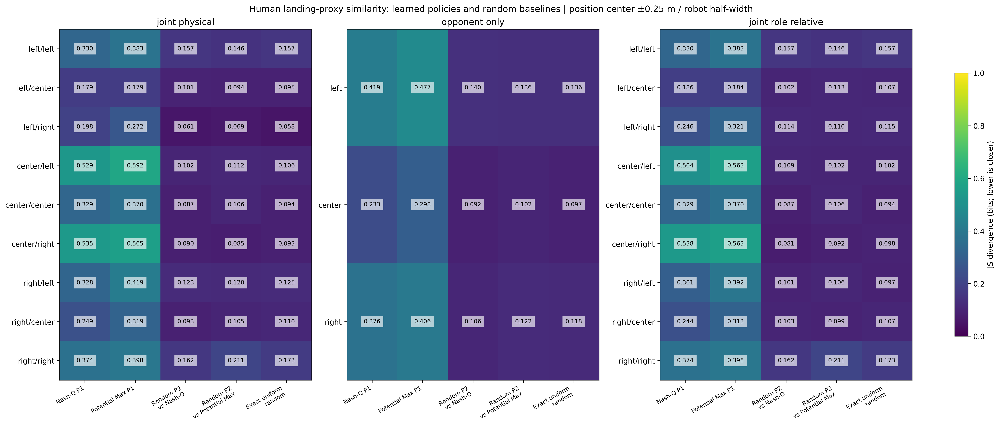
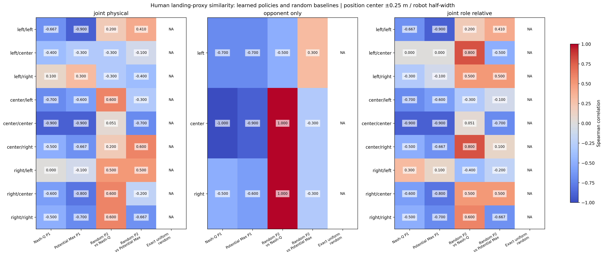

# Human similarity with empirical and exact random baselines

All values compare human **realized landing proxies** (four_quadrants_center_override) with robot **selected high-level skills**. Lower JS/TV means a closer category distribution, not better playing strength, win rate, or equivalent intentions. No simulations, reconstruction or model training were run.

## Inputs and baseline definitions

The saved incoming-aligned both-player human cohort is unchanged. Each learned policy remains P1. Random attackers are P2 in the existing runs, not a new P1 random evaluation. The two empirical random baselines are kept separate because they faced different learned opponents and visited different states. The exact uniform baseline is the existing random policy’s 20%-per-skill action distribution, verified against every logged random probability vector; it is not an observed landing distribution. Its sample count is blank rather than invented.

Observation totals: `{"human_both": 5741, "nash_q": 12203, "potential_max": 5881, "random_p2_vs_nash_q": 14702, "random_p2_vs_potential_max": 7251}`. Source snapshots validate inversion of the P2 canonical frame. Policies present in the earlier comparison must match its per-episode/physical-context/action counts; a newly selected policy is validated from its own detailed log and retains its actual name and sample size.

## Coordinate and conditioning conventions

Position center half-band = 0.25 m at robot scale, normalized by 0.7625 for both humans and robots. It applies to both players’ own-side positions. Source verification was performed at the original 0.05 m band before rebinning. Landing categories and the eligible shot cohort remain fixed; wider center bins redistribute observations rather than create shots.

Each player’s Left means their own left: P1 +world-y, P2 −world-y. joint_physical preserves the previous (physical P1,physical P2) ordering. Since learned attacks are P1 and logged random attacks P2, these physical-pair comparisons are not role-matched controls. The additional joint_role_relative view uses (hitter position,defender position), swapping the two bins for human or robot P2 attacks. opponent_only always uses the actual defender’s own-side position. All views pool raw counts and then normalize. Unequal visitation and sample counts remain explicit in the CSVs.

## Metrics and uncertainty

all_similarity_metrics.csv includes JS divergence in bits (not square-root distance), TV, Spearman and Pearson correlations, counts, and 95% cluster-bootstrap intervals. Correlation with an exactly uniform vector is mathematically undefined, so those cells are blank/NA. No zero correlation is substituted. Sparse/empty contexts and constant sampled vectors can also reduce the valid-replicate count.

comparison_metrics_wide.csv puts every model’s point metrics side by side in one row per context; separate *_metrics_wide.csv files contain each conditioning view. Detailed uncertainty remains in all_similarity_metrics.csv. Empirical Random correlations rank small sampling fluctuations around 20% and can therefore be unstable or accidentally high; these correlations are not evidence that Random learned a structured human-like response.

The 2000 replicates use seed 42. Human matches are resampled once per replicate across all human shots and contexts. For each robot run, one set of resampled rally weights is shared by the learned P1 and random P2 counts, including zero-decision clusters. Different saved runs are resampled independently. The exact uniform probabilities are fixed; their similarity intervals reflect human uncertainty only. Intervals are pointwise and do not include training-seed, reconstruction, or region-boundary uncertainty.

learned_vs_random_improvements.csv reports baseline JS/TV minus learned JS/TV; positive means the learned policy is closer. Correlation improvements are learned minus baseline. Positive differences are not claims of stronger gameplay. The shared human draws and within-run paired robot draws are retained in the difference intervals.

## Opponent-only results

| Context | Model | Human n | Model n | JS (bits) | TV | Spearman | Pearson |
|---|---|---:|---:|---:|---:|---:|---:|
| left | nash_q | 3305 | 3774 | 0.4189 | 0.6411 | -0.7000 | -0.5565 |
| center | nash_q | 1721 | 5097 | 0.2330 | 0.5039 | -1.0000 | -0.9351 |
| right | nash_q | 715 | 3332 | 0.3758 | 0.5951 | -0.5000 | -0.5292 |
| left | potential_max | 3305 | 1885 | 0.4773 | 0.6699 | -0.7000 | -0.5462 |
| center | potential_max | 1721 | 2308 | 0.2984 | 0.5624 | -0.9000 | -0.9286 |
| right | potential_max | 715 | 1688 | 0.4056 | 0.5624 | -0.6000 | -0.3816 |
| left | random_p2_vs_nash_q | 3305 | 3716 | 0.1396 | 0.3471 | -0.5000 | -0.1848 |
| center | random_p2_vs_nash_q | 1721 | 8095 | 0.0922 | 0.2924 | 1.0000 | 0.9850 |
| right | random_p2_vs_nash_q | 715 | 2891 | 0.1060 | 0.3077 | 1.0000 | 0.8148 |
| left | random_p2_vs_potential_max | 3305 | 1788 | 0.1355 | 0.3306 | 0.3000 | 0.1091 |
| center | random_p2_vs_potential_max | 1721 | 4054 | 0.1021 | 0.3090 | -0.3000 | -0.5345 |
| right | random_p2_vs_potential_max | 715 | 1409 | 0.1220 | 0.3340 | -0.3000 | -0.3431 |
| left | random_uniform_exact | 3305 | exact | 0.1364 | 0.3389 | NA | NA |
| center | random_uniform_exact | 1721 | exact | 0.0969 | 0.3012 | NA | NA |
| right | random_uniform_exact | 715 | exact | 0.1177 | 0.3259 | NA | NA |

## Nine physical-pair results

| Context | Model | Human n | Model n | JS (bits) | TV | Spearman | Pearson |
|---|---|---:|---:|---:|---:|---:|---:|
| left/left | nash_q | 2358 | 1277 | 0.3297 | 0.6144 | -0.6669 | -0.5415 |
| left/center | nash_q | 435 | 1896 | 0.1790 | 0.4205 | -0.4000 | -0.5247 |
| left/right | nash_q | 112 | 785 | 0.1981 | 0.4441 | 0.1000 | -0.0634 |
| center/left | nash_q | 1127 | 1763 | 0.5295 | 0.7207 | -0.7000 | -0.5676 |
| center/center | nash_q | 514 | 1115 | 0.3290 | 0.6005 | -0.9000 | -0.9467 |
| center/right | nash_q | 220 | 1433 | 0.5353 | 0.7391 | -0.5000 | -0.6578 |
| right/left | nash_q | 431 | 734 | 0.3279 | 0.5393 | 0.0000 | -0.3553 |
| right/center | nash_q | 367 | 2086 | 0.2494 | 0.5287 | -0.6000 | -0.8289 |
| right/right | nash_q | 177 | 1114 | 0.3740 | 0.5536 | -0.5000 | -0.5548 |
| left/left | potential_max | 2358 | 685 | 0.3826 | 0.6466 | -0.9000 | -0.5857 |
| left/center | potential_max | 435 | 478 | 0.1787 | 0.4281 | -0.3000 | -0.5159 |
| left/right | potential_max | 112 | 429 | 0.2720 | 0.5108 | 0.3000 | -0.0104 |
| center/left | potential_max | 1127 | 874 | 0.5922 | 0.7892 | -0.6000 | -0.5447 |
| center/center | potential_max | 514 | 946 | 0.3704 | 0.6098 | -0.9000 | -0.9387 |
| center/right | potential_max | 220 | 713 | 0.5645 | 0.7112 | -0.6669 | -0.5404 |
| right/left | potential_max | 431 | 326 | 0.4185 | 0.6017 | -0.1000 | -0.3852 |
| right/center | potential_max | 367 | 884 | 0.3192 | 0.5739 | -0.8000 | -0.7693 |
| right/right | potential_max | 177 | 546 | 0.3977 | 0.6055 | -0.7000 | -0.4080 |
| left/left | random_p2_vs_nash_q | 2358 | 1039 | 0.1574 | 0.3794 | 0.2000 | -0.0051 |
| left/center | random_p2_vs_nash_q | 435 | 1818 | 0.1011 | 0.3108 | -0.3000 | -0.4891 |
| left/right | random_p2_vs_nash_q | 112 | 859 | 0.0610 | 0.2557 | -0.3000 | -0.4428 |
| center/left | random_p2_vs_nash_q | 1127 | 2335 | 0.1016 | 0.2978 | 0.6000 | 0.5333 |
| center/center | random_p2_vs_nash_q | 514 | 3521 | 0.0873 | 0.2693 | 0.0513 | 0.6371 |
| center/right | random_p2_vs_nash_q | 220 | 2239 | 0.0898 | 0.2871 | 0.2000 | 0.5970 |
| right/left | random_p2_vs_nash_q | 431 | 779 | 0.1227 | 0.3345 | 0.5000 | 0.2115 |
| right/center | random_p2_vs_nash_q | 367 | 1442 | 0.0929 | 0.2824 | 0.6000 | 0.8064 |
| right/right | random_p2_vs_nash_q | 177 | 670 | 0.1624 | 0.3515 | 0.6000 | 0.6051 |
| left/left | random_p2_vs_potential_max | 2358 | 494 | 0.1459 | 0.3392 | 0.4104 | 0.4352 |
| left/center | random_p2_vs_potential_max | 435 | 887 | 0.0944 | 0.2991 | -0.1000 | 0.0893 |
| left/right | random_p2_vs_potential_max | 112 | 407 | 0.0687 | 0.2659 | -0.4000 | -0.4297 |
| center/left | random_p2_vs_potential_max | 1127 | 1175 | 0.1122 | 0.3178 | -0.3000 | -0.5102 |
| center/center | random_p2_vs_potential_max | 514 | 1752 | 0.1065 | 0.3023 | -0.7000 | -0.7237 |
| center/right | random_p2_vs_potential_max | 220 | 1127 | 0.0851 | 0.2743 | 0.6000 | 0.5828 |
| right/left | random_p2_vs_potential_max | 431 | 355 | 0.1199 | 0.3271 | 0.5000 | 0.2899 |
| right/center | random_p2_vs_potential_max | 367 | 689 | 0.1053 | 0.3001 | -0.2000 | 0.2266 |
| right/right | random_p2_vs_potential_max | 177 | 365 | 0.2107 | 0.4262 | -0.6669 | -0.6214 |
| left/left | random_uniform_exact | 2358 | exact | 0.1570 | 0.3663 | NA | NA |
| left/center | random_uniform_exact | 435 | exact | 0.0948 | 0.2989 | NA | NA |
| left/right | random_uniform_exact | 112 | exact | 0.0582 | 0.2482 | NA | NA |
| center/left | random_uniform_exact | 1127 | exact | 0.1063 | 0.3051 | NA | NA |
| center/center | random_uniform_exact | 514 | exact | 0.0935 | 0.2794 | NA | NA |
| center/right | random_uniform_exact | 220 | exact | 0.0933 | 0.2955 | NA | NA |
| right/left | random_uniform_exact | 431 | exact | 0.1246 | 0.3327 | NA | NA |
| right/center | random_uniform_exact | 367 | exact | 0.1095 | 0.3155 | NA | NA |
| right/right | random_uniform_exact | 177 | exact | 0.1729 | 0.3605 | NA | NA |

## Role-matched joint sensitivity

| Context | Model | Human n | Model n | JS (bits) | TV | Spearman | Pearson |
|---|---|---:|---:|---:|---:|---:|---:|
| left/left | nash_q | 2358 | 1277 | 0.3297 | 0.6144 | -0.6669 | -0.5415 |
| left/center | nash_q | 860 | 1896 | 0.1855 | 0.4321 | 0.0000 | -0.4751 |
| left/right | nash_q | 298 | 785 | 0.2464 | 0.4581 | -0.3000 | -0.0573 |
| center/left | nash_q | 702 | 1763 | 0.5035 | 0.7102 | -0.7000 | -0.5150 |
| center/center | nash_q | 514 | 1115 | 0.3290 | 0.6005 | -0.9000 | -0.9467 |
| center/right | nash_q | 240 | 1433 | 0.5383 | 0.7479 | -0.5000 | -0.6475 |
| right/left | nash_q | 245 | 734 | 0.3009 | 0.5205 | 0.3000 | -0.3831 |
| right/center | nash_q | 347 | 2086 | 0.2441 | 0.5238 | -0.6000 | -0.8095 |
| right/right | nash_q | 177 | 1114 | 0.3740 | 0.5536 | -0.5000 | -0.5548 |
| left/left | potential_max | 2358 | 685 | 0.3826 | 0.6466 | -0.9000 | -0.5857 |
| left/center | potential_max | 860 | 478 | 0.1842 | 0.4398 | 0.0000 | -0.4428 |
| left/right | potential_max | 298 | 429 | 0.3206 | 0.5090 | -0.1000 | -0.0193 |
| center/left | potential_max | 702 | 874 | 0.5628 | 0.7714 | -0.6000 | -0.4901 |
| center/center | potential_max | 514 | 946 | 0.3704 | 0.6098 | -0.9000 | -0.9387 |
| center/right | potential_max | 240 | 713 | 0.5632 | 0.7100 | -0.6669 | -0.5290 |
| right/left | potential_max | 245 | 326 | 0.3924 | 0.5829 | 0.1000 | -0.4166 |
| right/center | potential_max | 347 | 884 | 0.3133 | 0.5690 | -0.8000 | -0.7524 |
| right/right | potential_max | 177 | 546 | 0.3977 | 0.6055 | -0.7000 | -0.4080 |
| left/left | random_p2_vs_nash_q | 2358 | 1039 | 0.1574 | 0.3794 | 0.2000 | -0.0051 |
| left/center | random_p2_vs_nash_q | 860 | 2335 | 0.1017 | 0.3032 | 0.8000 | 0.5599 |
| left/right | random_p2_vs_nash_q | 298 | 779 | 0.1137 | 0.3246 | 0.5000 | 0.1981 |
| center/left | random_p2_vs_nash_q | 702 | 1818 | 0.1086 | 0.3069 | -0.3000 | -0.4460 |
| center/center | random_p2_vs_nash_q | 514 | 3521 | 0.0873 | 0.2693 | 0.0513 | 0.6371 |
| center/right | random_p2_vs_nash_q | 240 | 1442 | 0.0813 | 0.2710 | 0.8000 | 0.8579 |
| right/left | random_p2_vs_nash_q | 245 | 859 | 0.1008 | 0.3136 | -0.4000 | -0.4647 |
| right/center | random_p2_vs_nash_q | 347 | 2239 | 0.1034 | 0.3024 | 0.5000 | 0.6287 |
| right/right | random_p2_vs_nash_q | 177 | 670 | 0.1624 | 0.3515 | 0.6000 | 0.6051 |
| left/left | random_p2_vs_potential_max | 2358 | 494 | 0.1459 | 0.3392 | 0.4104 | 0.4352 |
| left/center | random_p2_vs_potential_max | 860 | 1175 | 0.1129 | 0.3232 | -0.5000 | -0.5486 |
| left/right | random_p2_vs_potential_max | 298 | 355 | 0.1103 | 0.3172 | 0.5000 | 0.3011 |
| center/left | random_p2_vs_potential_max | 702 | 887 | 0.1019 | 0.2948 | -0.1000 | 0.0366 |
| center/center | random_p2_vs_potential_max | 514 | 1752 | 0.1065 | 0.3023 | -0.7000 | -0.7237 |
| center/right | random_p2_vs_potential_max | 240 | 689 | 0.0925 | 0.2888 | 0.1000 | 0.3245 |
| right/left | random_p2_vs_potential_max | 245 | 407 | 0.1062 | 0.3238 | -0.2000 | -0.2398 |
| right/center | random_p2_vs_potential_max | 347 | 1127 | 0.0990 | 0.2895 | 0.5000 | 0.5378 |
| right/right | random_p2_vs_potential_max | 177 | 365 | 0.2107 | 0.4262 | -0.6669 | -0.6214 |
| left/left | random_uniform_exact | 2358 | exact | 0.1570 | 0.3663 | NA | NA |
| left/center | random_uniform_exact | 860 | exact | 0.1066 | 0.3105 | NA | NA |
| left/right | random_uniform_exact | 298 | exact | 0.1152 | 0.3228 | NA | NA |
| center/left | random_uniform_exact | 702 | exact | 0.1020 | 0.2980 | NA | NA |
| center/center | random_uniform_exact | 514 | exact | 0.0935 | 0.2794 | NA | NA |
| center/right | random_uniform_exact | 240 | exact | 0.0978 | 0.3042 | NA | NA |
| right/left | random_uniform_exact | 245 | exact | 0.0971 | 0.3061 | NA | NA |
| right/center | random_uniform_exact | 347 | exact | 0.1073 | 0.3107 | NA | NA |
| right/right | random_uniform_exact | 177 | exact | 0.1729 | 0.3605 | NA | NA |

## Comparison against exact uniform random

| View | Policy | Closer JS point estimates | Farther JS point estimates | Total contexts |
|---|---|---:|---:|---:|
| joint_physical | nash_q | 0 | 9 | 9 |
| joint_physical | potential_max | 0 | 9 | 9 |
| opponent_only | nash_q | 0 | 3 | 3 |
| opponent_only | potential_max | 0 | 3 | 3 |
| joint_role_relative | nash_q | 0 | 9 | 9 |
| joint_role_relative | potential_max | 0 | 9 | 9 |

Inspect the improvement intervals before interpreting a point ordering. State visitation, physical role, and the human-successful-landing versus robot-all-selections distinction remain possible confounds. Exact-uniform and empirical-random results are labeled separately.

## Reproduce

```bash
OPENBLAS_NUM_THREADS=1 python3 v3/human_comparison/analyze_random_similarity.py --input-dir v3/human_comparison/reports/opponent_position_comparison_10k_both --nash-decisions skill_eval/v3/nash_vs_random_10000/decisions.csv --potential-policy potential_max --potential-decisions skill_eval/v3/potential_max_vs_random/decisions.csv --center-band 0.25 --bootstrap 2000 --seed 42 --output-dir v3/human_comparison/reports/potential_max_vs_human_center_0p25
```

Previous reports are unchanged. Inputs, metadata, validation counts and hashes are recorded in audit.json.




